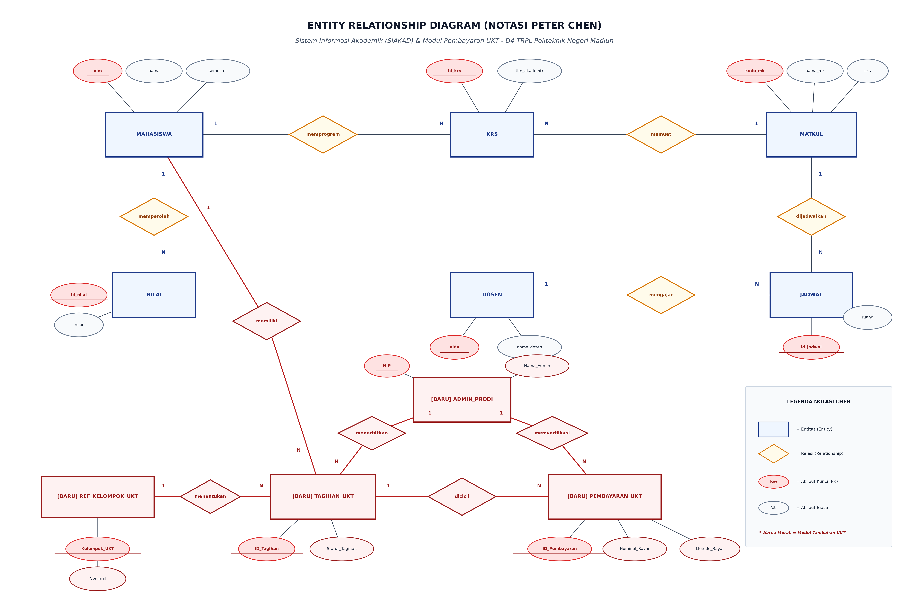
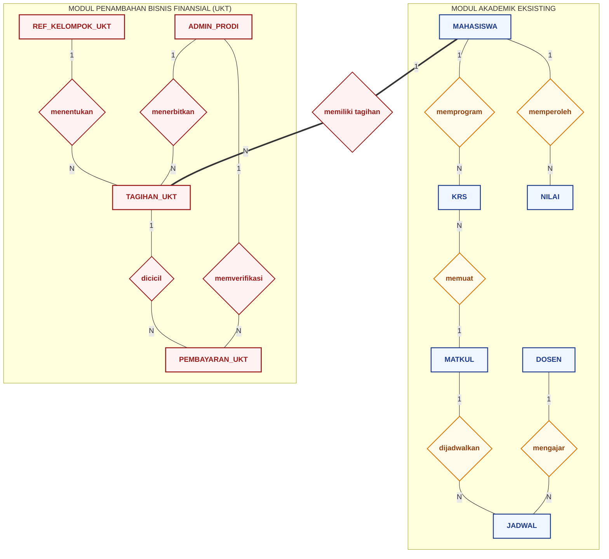

# LAPORAN EVALUASI MANDIRI BASIS DATA
## Transformasi Penambahan Proses Bisnis Pembayaran UKT & Validasi KRS pada Sistem Informasi Akademik (SIAKAD / Edlink)

---

### Informasi Mahasiswa & Penugasan
* **Nama Lengkap** : Muhammad Amirul Hafidz
* **NIM** : 264311048
* **Kelas** : TRPL 1B
* **Program Studi** : D4 Teknologi Rekayasa Perangkat Lunak
* **Jurusan** : Teknik, Politeknik Negeri Madiun (PNM)
* **Mata Kuliah** : Basis Data
* **Semester** : 2026 Ganjil


---

## 1. Latar Belakang Studi Kasus & Identifikasi Tantangan Bisnis

### 1.1 Kondisi Eksisting Proyek Kelompok
Pada proyek kelompok mata kuliah praktik basis data sebelumnya, tim merancang sistem informasi akademik berbasis web (serupa platform **Edlink / SIAKAD**). Sistem awal tersebut berfokus pada digitalisasi kegiatan belajar-mengajar dasar di kampus, dengan tabel inti yang mencakup:
* `mahasiswa`: Menyimpan identitas mahasiswa aktif.
* `dosen`: Menyimpan data pengajar (NIDN dan nama).
* `matkul`: Katalog mata kuliah beserta bobot SKS.
* `jadwal`: Alokasi ruang dan waktu perkuliahan.
* `krs`: Formulir Kartu Rencana Studi yang diambil mahasiswa.
* `nilai`: Hasil evaluasi akademik per mata kuliah.

### 1.2 Tantangan Bisnis yang Muncul
Seiring pengujian operasional dan telaah alur bisnis kampus yang sesungguhnya, sistem informasi kelompok menghadapi beberapa tantangan kritis pada aspek tata kelola keuangan dan kepatuhan akademik:

1. **Ketiadaan Validasi Finansial pada Pengisian KRS**:
   * Pada sistem lama, relasi pengisian KRS hanya mengecek ketersediaan mata kuliah. Mahasiswa yang belum melunasi biaya kuliah (Uang Kuliah Tunggal / UKT) dapat langsung memilih mata kuliah dan mendapatkan jadwal.
   * Hal ini merugikan pihak kampus karena berpotensi menimbulkan piutang tak tertagih dan melanggar Standar Operasional Prosedur (SOP) akademik di Politeknik.
2. **Pencatatan Keuangan Terpisah dan Rawan Selisih**:
   * Data pembayaran mahasiswa dicatat secara manual di luar sistem akademik atau spreadsheet terpisah, sehingga bagian Program Studi kesulitan melakukan sinkronisasi data secara *real-time*.
3. **Kebutuhan Fasilitas Pembayaran Bertahap (Cicilan)**:
   * Kondisi ekonomi mahasiswa bervariasi; sistem membutuhkan mekanisme pencatatan cicilan resmi, di mana satu tagihan semester dapat dibayar lebih dari satu kali hingga statusnya berubah menjadi lunas.
4. **Verifikasi Otoritatif oleh Bagian Keuangan/Admin Prodi**:
   * Pembayaran via transfer manual, QRIS, atau tunai memerlukan mekanisme audit dan persetujuan formal oleh staf administrasi program studi (`admin_prodi`) sebelum hak KRS mahasiswa diaktifkan.

### 1.3 Solusi Penambahan Proses Bisnis
Untuk mengatasi tantangan di atas, dilakukan rekayasa ulang dan penambahan alur bisnis baru ke dalam database `kuliah`:
1. **Penambahan Entitas Pengelola (`admin_prodi`)**:
   Staf prodi bertindak sebagai operator yang menerbitkan tagihan UKT semesteran dan memverifikasi bukti transaksi pembayaran mahasiswa menggunakan NIP sebagai identitas unik.
2. **Standardisasi Tarif (`ref_kelompok_ukt`)**:
   Pengelompokan nominal UKT berjenjang (Kelompok 1 sampai 8) sesuai keputusan perguruan tinggi untuk menjaga konsistensi data.
3. **Penerbitan Tagihan Semesteran (`tagihan_ukt`)**:
   Tagihan otomatis diterbitkan sebelum masa KRS dimulai, memuat tanggal jatuh tempo, nominal berdasarkan kelompok UKT mahasiswa, dan status tagihan (`BELUM BAYAR`, `CICILAN`, `LUNAS`).
4. **Pencatatan Riwayat Transaksi (`pembayaran_ukt`)**:
   Mencatat setiap transaksi cicilan mahasiswa beserta bukti setor, metode bayar (Transfer, VA Bank, QRIS, Tunai), status verifikasi (`PENDING`, `TERVERIFIKASI`, `DITOLAK`), dan NIP petugas verifikator.
5. **Mekanisme Gerbang Validasi KRS (*KRS Enrollment Gate*)**:
   Hak mahasiswa untuk memasukkan rekaman ke dalam tabel `krs` dibatasi secara kondisional: sistem hanya mengizinkan pengisian KRS jika tagihan UKT semester bersangkutan telah berstatus `LUNAS`.

### 1.4 Aturan Bisnis (*Business Rules*) Terstruktur
* **BR-01**: Setiap mahasiswa aktif wajib memiliki 1 (satu) tagihan UKT per semester aktif.
* **BR-02**: Tagihan UKT diterbitkan oleh seorang Admin Prodi yang sah terdaftar.
* **BR-03**: Nominal tagihan merujuk pada tabel referensi kelompok UKT mahasiswa (tidak boleh diinput manual tanpa referensi).
* **BR-04**: Satu tagihan UKT dapat dibayar melalui satu atau beberapa transaksi pembayaran (cicilan bertahap).
* **BR-05**: Setiap pembayaran wajib diverifikasi oleh Admin Prodi. Hanya pembayaran berstatus `TERVERIFIKASI` yang mengurangi sisa tagihan.
* **BR-06**: Status tagihan dinyatakan `LUNAS` jika akumulasi pembayaran terverifikasi sama dengan atau melebihi nominal UKT kelompok yang ditentukan.
* **BR-07**: Mahasiswa hanya diizinkan memprogram KRS pada semester berjalan apabila status tagihannya telah `LUNAS`.

---

## 2. Pemodelan Konseptual: Entity-Relationship Diagram (ERD) Notasi Peter Chen

Pemodelan konseptual ini disusun menggunakan **Notasi Peter Chen (1976)**, yang merupakan standar formal pemodelan data semantik konseptual sebelum ditransformasikan ke skema relasional fisik.

### 2.1 Kaidah & Simbol Notasi Peter Chen

Notasi Peter Chen menggunakan simbol-simbol grafis murni sebagai berikut:
1. **Entitas (Entity)**: Digambarkan dengan bangun **Persegi Panjang** (*Rectangle*), merepresentasikan himpunan objek nyata yang informasi datanya disimpan di dalam sistem.
2. **Relasi (Relationship)**: Digambarkan dengan bangun **Belah Ketupat / Intan** (*Diamond* / *Rhombus*), merepresentasikan keterhubungan atau aksi antara dua atau lebih entitas. Nama relasi dituliskan menggunakan kata kerja aktif.
3. **Atribut (Attribute)**: Digambarkan dengan bangun **Elips / Oval** (*Ellipse*) yang terhubung langsung dengan garis ke entitas pemiliknya.
   * **Atribut Kunci (Primary Key / Key Attribute)**: Oval dengan nama atribut yang **diberi garis bawah** (*underlined*) atau penanda `(PK)`.
   * **Atribut Deskriptif**: Oval standar berisi properti non-kunci dari entitas.
4. **Derajat Relasi & Rasio Kardinalitas (Cardinality Ratio)**: Dituliskan berupa rasio numerik **`1`** (*One*) dan **`N` / `M`** (*Many*) pada tepi garis penghubung antara belah ketupat relasi dan persegi panjang entitas.

---

### 2.2 Identifikasi Entitas & Klasifikasi Peran

| No | Nama Entitas | Bentuk Notasi Chen | Jenis | Peran dalam Sistem |
| :---: | :--- | :--- | :--- | :--- |
| 1 | `mahasiswa` | Persegi Panjang | Eksisting (Master) | Subjek utama yang menempuh studi dan memiliki kewajiban UKT. |
| 2 | `admin_prodi` | Persegi Panjang | Baru (Master) | Tenaga kependidikan pengelola tagihan dan verifikator keuangan prodi. |
| 3 | `ref_kelompok_ukt`| Persegi Panjang | Baru (Referensi) | Tabel lookup tarif UKT kelompok 1 s/d 8. |
| 4 | `tagihan_ukt` | Persegi Panjang | Baru (Transaksi Induk) | Lembar kewajiban bayar mahasiswa per semester. |
| 5 | `pembayaran_ukt` | Persegi Panjang | Baru (Transaksi Rinci)| Detail transaksi setoran dana dan bukti transfer. |
| 6 | `matkul` | Persegi Panjang | Eksisting (Master) | Mata kuliah yang ditawarkan di program studi. |
| 7 | `dosen` | Persegi Panjang | Eksisting (Master) | Pengampu mata kuliah dan pembina akademik. |
| 8 | `jadwal` | Persegi Panjang | Eksisting (Operasional)| Waktu, hari, dan ruang pelaksanaan mata kuliah. |
| 9 | `krs` | Persegi Panjang | Eksisting (Transaksi) | Rencana studi semesteran mahasiswa yang terkunci jika UKT belum lunas. |
| 10 | `nilai` | Persegi Panjang | Eksisting (Evaluasi) | Nilai huruf/angka hasil studi mahasiswa. |

---

### 2.3 Identifikasi Entitas & Atribut (Kamus Data Notasi Chen)

Berikut adalah pemetaan entitas dan atribut lengkap dengan penandaan Primary Key (`PK`):

| No | Entitas (Persegi Panjang) | Atribut Kunci (Elips Garis Bawah) | Atribut Deskriptif (Elips Standar) | Keterangan Status |
| :---: | :--- | :--- | :--- | :--- |
| 1 | `ADMIN_PRODI` | <u>`NIP`</u> | `Nama_Admin`, `Email`, `No_Telepon` | Entitas Baru (Pengelola) |
| 2 | `REF_KELOMPOK_UKT` | <u>`Kelompok_UKT`</u> | `Nominal` | Entitas Baru (Lookup Tarif) |
| 3 | `TAGIHAN_UKT` | <u>`ID_Tagihan`</u> | `Semester`, `Tahun_Akademik`, `Tgl_Jatuh_Tempo`, `Status_Tagihan`, `Tgl_Lunas` | Entitas Baru (Transaksi Induk) |
| 4 | `PEMBAYARAN_UKT` | <u>`ID_Pembayaran`</u> | `Metode_Bayar`, `Nominal_Bayar`, `Tgl_Bayar`, `Bukti_Bayar`, `Status_Verifikasi`, `Tgl_Verifikasi`, `Keterangan` | Entitas Baru (Transaksi Rinci) |
| 5 | `MAHASISWA` | <u>`nim`</u> | `nama`, `semester` | Entitas Eksisting |
| 6 | `KRS` | <u>`id_krs`</u> | `semester`, `tahun_akademik` | Entitas Eksisting (Terkunci jika UKT belum lunas) |
| 7 | `MATKUL` | <u>`kode_mk`</u> | `nama_mk`, `sks` | Entitas Eksisting |
| 8 | `DOSEN` | <u>`nidn`</u> | `nama_dosen` | Entitas Eksisting |
| 9 | `JADWAL` | <u>`id_jadwal`</u> | `hari`, `jam`, `ruang` | Entitas Eksisting |
| 10 | `NILAI` | <u>`id_nilai`</u> | `nilai`, `semester` | Entitas Eksisting |

---

### 2.4 Pemetaan Relasi & Rasio Kardinalitas (Notasi Chen)

Pada notasi Chen, Foreign Key tidak digambarkan sebagai atribut mandiri di dalam entitas anak, melainkan direpresentasikan secara semantik melalui belah ketupat relasi (*relationship set*):

```text
[ADMIN_PRODI]       --- (1) --- <menerbitkan>   --- (N) --- [TAGIHAN_UKT]
[ADMIN_PRODI]       --- (1) --- <memverifikasi> --- (N) --- [PEMBAYARAN_UKT]
[REF_KELOMPOK_UKT]  --- (1) --- <menentukan>    --- (N) --- [TAGIHAN_UKT]
[MAHASISWA]         --- (1) --- <memiliki>      --- (N) --- [TAGIHAN_UKT]
[TAGIHAN_UKT]       --- (1) --- <dicicil>       --- (N) --- [PEMBAYARAN_UKT]
[MAHASISWA]         --- (1) --- <memprogram>    --- (N) --- [KRS]
[MATKUL]            --- (1) --- <diambil>       --- (N) --- [KRS]
[MATKUL]            --- (1) --- <dijadwalkan>   --- (N) --- [JADWAL]
[DOSEN]             --- (1) --- <mengajar>      --- (N) --- [JADWAL]
[MAHASISWA]         --- (1) --- <memperoleh>    --- (N) --- [NILAI]
[MATKUL]            --- (1) --- <dinilai>       --- (N) --- [NILAI]
```

*Penjelasan Aturan Kardinalitas*:
1. **`ADMIN_PRODI` --- (1) --- `<menerbitkan>` --- (N) --- `TAGIHAN_UKT`**:
   Satu orang Admin Program Studi dapat menerbitkan banyak tagihan UKT ($1:N$). Setiap tagihan diterbitkan oleh tepat satu admin penanggung jawab.
2. **`ADMIN_PRODI` --- (1) --- `<memverifikasi>` --- (N) --- `PEMBAYARAN_UKT`**:
   Satu Admin Prodi memverifikasi banyak catatan transaksi pembayaran cicilan ($1:N$).
3. **`REF_KELOMPOK_UKT` --- (1) --- `<menentukan>` --- (N) --- `TAGIHAN_UKT`**:
   Satu golongan tarif kelompok UKT (1 s/d 8) menentukan nominal pada banyak tagihan mahasiswa ($1:N$).
4. **`MAHASISWA` --- (1) --- `<memiliki>` --- (N) --- `TAGIHAN_UKT`**:
   Satu mahasiswa memiliki riwayat kewajiban tagihan per semester ($1:N$). Setiap lembar tagihan hanya milik satu mahasiswa.
5. **`TAGIHAN_UKT` --- (1) --- `<dicicil>` --- (N) --- `PEMBAYARAN_UKT`**:
   Satu tagihan UKT dapat dilunasi melalui satu atau beberapa transaksi pembayaran ($1:N$).
6. **`MAHASISWA` --- (1) --- `<memprogram>` --- (N) --- `KRS`**:
   Mahasiswa yang status tagihannya telah `LUNAS` berhak memprogram banyak mata kuliah dalam form KRS semester ($1:N$).
7. **`MATKUL` --- (1) --- `<diambil>` --- (N) --- `KRS`**:
   Satu mata kuliah dapat diambil oleh banyak mahasiswa dalam KRS ($1:N$).

---

### 2.5 Diagram Visual Notasi Peter Chen

#### A. Gambar Diagram Notasi Chen (Grafis Penuh)
Berikut adalah visualisasi lengkap diagram ERD dengan Notasi Peter Chen yang membedakan entitas eksisting akademik dan entitas baru modul penambahan UKT:


*Gambar 2.1: Diagram Konseptual ERD Sistem Akademik & Pembayaran UKT menggunakan Notasi Peter Chen (Entitas = Persegi Panjang, Relasi = Belah Ketupat, Atribut = Oval, Underline = Primary Key).*

---

#### B. Diagram Alur Semantik Notasi Chen (Mermaid Flowchart Berstruktur Modul)
Untuk menjaga kerapian tampilan dan menghindari persilangan garis acak (*spaghetti lines*) pada rendering Markdown GitHub, relasi Notasi Chen dikelompokkan secara terstruktur ke dalam dua sub-modul yang saling terintegrasi:



---

### 2.6 Panduan Membuka & Mengedit Notasi Chen Presisi di [app.diagrams.net](https://app.diagrams.net/)

Agar kamu mendapatkan diagram Notasi Chen yang **100% rapi, simetris, sejajar pada grid 10px, dan siap diekspor**:
1. Telah disediakan berkas diagram XML khusus Notasi Chen: **`erd_chen_siakad_ukt.drawio`** pada repositori ini.
2. Buka web editor **[app.diagrams.net](https://app.diagrams.net/)**.
3. Pilih **Open Existing Diagram** -> pilih berkas **`erd_chen_siakad_ukt.drawio`**.
4. Semua elemen (Persegi Panjang Entitas, Belah Ketupat Relasi, dan Oval Atribut) telah disusun simetris pada 3 baris grid tanpa ada garis yang saling bertubrukan.

---

## 3. Pemodelan Logis: Skema Relasional & Normalisasi (1NF Hingga 3NF)

Tahap pemodelan logis bertujuan menjamin integritas relasional, menghilangkan redundansi data, serta mencegah anomali (*insertion*, *update*, dan *deletion anomaly*).

### 3.1 Skema Relasional Awal (Format Teks Relasional)

Notasi: `NAMA_TABEL (PK, Non-Key Attributes..., FK)`
* `ADMIN_PRODI` (`NIP`, `Nama_Admin`, `Email`, `No_Telepon`)
* `REF_KELOMPOK_UKT` (`Kelompok_UKT`, `Nominal`)
* `MAHASISWA` (`nim`, `nama`, `semester`)
* `TAGIHAN_UKT` (`ID_Tagihan`, `NIM`*, `Semester`, `Tahun_Akademik`, `Kelompok_UKT`*, `Tgl_Jatuh_Tempo`, `Status_Tagihan`, `Tgl_Lunas`, `NIP_Penerbit`*)
* `PEMBAYARAN_UKT` (`ID_Pembayaran`, `ID_Tagihan`*, `Metode_Bayar`, `Nominal_Bayar`, `Tgl_Bayar`, `Bukti_Bayar`, `Status_Verifikasi`, `Tgl_Verifikasi`, `NIP_Verifikator`*, `Keterangan`)
* `KRS` (`id_krs`, `nim`*, `kode_mk`*, `semester`, `tahun_akademik`)
* `MATKUL` (`kode_mk`, `nama_mk`, `sks`)

---

### 3.2 Proses Uji Normalisasi Bertahap

#### A. Bentuk Tidak Ternormalisasi (UNF - Unnormalized Form)
Jika data proses penagihan dan pembayaran digabung secara naif dalam satu dokumen/tabel tunggal seperti faktur kertas:

```text
DATA_TAGIHAN_PEMBAYARAN_UNF:
{
    ID_Tagihan, NIM, Nama_Mhs, Semester_Mhs, Tahun_Akademik, 
    Kelompok_UKT, Nominal_UKT, Tgl_Jatuh_Tempo, Status_Tagihan,
    NIP_Admin, Nama_Admin,
    (ID_Pembayaran, Tgl_Bayar, Nominal_Bayar, Metode_Bayar, Status_Verif, NIP_Verifikator)* -> Repeating Group Pembayaran
}
```
*Masalah pada UNF*: Terdapat perulangan kelompok data pembayaran (*repeating group*) di mana satu tagihan memiliki banyak baris cicilan dalam satu baris record.

---

#### B. Bentuk Normal Pertama (1NF - First Normal Form)
*Syarat 1NF*:
1. Setiap atribut hanya berisi nilai atomik (tunggal, tidak bernilai ganda atau komposit).
2. Tidak ada kelompok atribut yang berulang (*repeating groups*).
3. Memiliki Primary Key yang unik.

*Langkah Transformasi*:
Memisahkan perulangan baris cicilan menjadi baris data terpisah, dengan Primary Key gabungan komposit: `(ID_Tagihan, ID_Pembayaran)`.

Tabel pada tahap 1NF:
```text
TABEL_1NF (
    <u>ID_Tagihan</u>, 
    <u>ID_Pembayaran</u>, 
    NIM, 
    Nama_Mhs, 
    Semester, 
    Tahun_Akademik, 
    Kelompok_UKT, 
    Nominal_UKT, 
    Tgl_Jatuh_Tempo, 
    Status_Tagihan, 
    NIP_Penerbit, 
    Nama_Penerbit, 
    Metode_Bayar, 
    Nominal_Bayar, 
    Tgl_Bayar, 
    Status_Verif, 
    NIP_Verifikator, 
    Nama_Verifikator
)
```

*Analisis Functional Dependency (FD) pada 1NF*:
* $FD_1$: `ID_Tagihan` $\to$ `NIM`, `Nama_Mhs`, `Semester`, `Tahun_Akademik`, `Kelompok_UKT`, `Nominal_UKT`, `Tgl_Jatuh_Tempo`, `Status_Tagihan`, `NIP_Penerbit`, `Nama_Penerbit` (Hanya bergantung pada sebagian PK).
* $FD_2$: `ID_Pembayaran` $\to$ `Metode_Bayar`, `Nominal_Bayar`, `Tgl_Bayar`, `Status_Verif`, `NIP_Verifikator`, `Nama_Verifikator`, `ID_Tagihan` (Bergantung pada sebagian PK lainnya).
* $FD_3$: `NIM` $\to$ `Nama_Mhs`.
* $FD_4$: `Kelompok_UKT` $\to$ `Nominal_UKT`.
* $FD_5$: `NIP_Penerbit` $\to$ `Nama_Penerbit`.

*Kelemahan 1NF*: Terjadi **Ketergantungan Parsial (Partial Functional Dependency)** karena atribut `NIM`, `Semester`, `Status_Tagihan` hanya bergantung pada `ID_Tagihan`, bukan pada pasangan `(ID_Tagihan, ID_Pembayaran)`.

---

#### C. Bentuk Normal Kedua (2NF - Second Normal Form)
*Syarat 2NF*:
1. Telah memenuhi kriteria 1NF.
2. Tidak boleh ada **ketergantungan parsial** (*partial dependency*); setiap atribut non-primary key wajib bergantung sepenuhnya pada seluruh Primary Key (*full functional dependency*).

*Langkah Transformasi*:
Pisahkan tabel yang memiliki ketergantungan parsial menjadi entitas tersendiri:
1. Pisahkan kelompok data tagihan menjadi tabel `TAGIHAN_UKT_2NF` dengan PK `ID_Tagihan`.
2. Pisahkan data transaksi pembayaran menjadi tabel `PEMBAYARAN_UKT_2NF` dengan PK `ID_Pembayaran` dan FK `ID_Tagihan`.

Hasil Pemecahan 2NF:
```text
1. TAGIHAN_UKT_2NF (
    <u>ID_Tagihan</u>, 
    NIM, 
    Nama_Mhs, 
    Semester, 
    Tahun_Akademik, 
    Kelompok_UKT, 
    Nominal_UKT, 
    Tgl_Jatuh_Tempo, 
    Status_Tagihan, 
    NIP_Penerbit, 
    Nama_Penerbit
)

2. PEMBAYARAN_UKT_2NF (
    <u>ID_Pembayaran</u>, 
    ID_Tagihan*, 
    Metode_Bayar, 
    Nominal_Bayar, 
    Tgl_Bayar, 
    Bukti_Bayar, 
    Status_Verifikasi, 
    Tgl_Verifikasi, 
    NIP_Verifikator, 
    Nama_Verifikator, 
    Keterangan
)
```

*Analisis Ketergantungan pada 2NF*:
Ketergantungan parsial telah hilang. Namun, masih terdapat **Ketergantungan Transitif (Transitive Dependency)**:
* Pada tabel tagihan: `ID_Tagihan` $\to$ `Kelompok_UKT` $\to$ `Nominal_UKT` (Atribut non-key `Nominal_UKT` ditentukan oleh atribut non-key `Kelompok_UKT`).
* Pada tabel tagihan: `ID_Tagihan` $\to$ `NIM` $\to$ `Nama_Mhs`.
* Pada tabel tagihan/pembayaran: `ID_Tagihan` $\to$ `NIP_Penerbit` $\to$ `Nama_Penerbit`.

---

#### D. Bentuk Normal Ketiga (3NF - Third Normal Form)
*Syarat 3NF*:
1. Telah memenuhi kriteria 2NF.
2. Tidak boleh ada **ketergantungan transitif** (*transitive dependency*); setiap atribut non-key hanya boleh bergantung langsung pada Primary Key (jika $X \to Y$ dan $Y \to Z$, maka $Z$ harus dipisahkan).

*Langkah Transformasi*:
1. Eliminasi transitif `Kelompok_UKT` $\to$ `Nominal_UKT`: Buat tabel lookup baru `REF_KELOMPOK_UKT (<u>Kelompok_UKT</u>, Nominal)`.
2. Eliminasi transitif `NIM` $\to$ `Nama_Mhs`: Atribut `Nama_Mhs` dipertahankan hanya pada tabel `MAHASISWA (<u>nim</u>, nama, semester)`.
3. Eliminasi transitif `NIP` $\to$ `Nama_Admin`: Atribut nama dan kontak admin dipisahkan ke tabel `ADMIN_PRODI (<u>NIP</u>, Nama_Admin, Email, No_Telepon)`.

---

### 3.3 Skema Akhir Hasil Normalisasi (3NF Teroptimasi)

Struktur tabel di bawah ini telah bersih dari anomali pembaruan, redundansi tarif, dan siap diimplementasikan secara fisik:

```text
1. ADMIN_PRODI (
    <u>NIP</u> [PK], 
    Nama_Admin, 
    Email, 
    No_Telepon
)

2. REF_KELOMPOK_UKT (
    <u>Kelompok_UKT</u> [PK], 
    Nominal
)

3. MAHASISWA (
    <u>nim</u> [PK], 
    nama, 
    semester
)

4. TAGIHAN_UKT (
    <u>ID_Tagihan</u> [PK], 
    NIM [FK -> MAHASISWA.nim], 
    Semester, 
    Tahun_Akademik, 
    Kelompok_UKT [FK -> REF_KELOMPOK_UKT.Kelompok_UKT], 
    Tgl_Jatuh_Tempo, 
    Status_Tagihan, 
    Tgl_Lunas, 
    NIP_Penerbit [FK -> ADMIN_PRODI.NIP]
)

5. PEMBAYARAN_UKT (
    <u>ID_Pembayaran</u> [PK], 
    ID_Tagihan [FK -> TAGIHAN_UKT.ID_Tagihan], 
    Metode_Bayar, 
    Nominal_Bayar, 
    Tgl_Bayar, 
    Bukti_Bayar, 
    Status_Verifikasi, 
    Tgl_Verifikasi, 
    NIP_Verifikator [FK -> ADMIN_PRODI.NIP], 
    Keterangan
)

6. KRS (
    <u>id_krs</u> [PK], 
    nim [FK -> MAHASISWA.nim], 
    kode_mk [FK -> MATKUL.kode_mk], 
    semester, 
    tahun_akademik
)
```

---

## 4. Pemodelan Fisik: Implementasi SQL DDL & Validasi Database Nyata

Struktur fisik di bawah ini disinkronkan langsung dengan database aktual `kuliah` pada lingkungan `localhost/phpmyadmin` (MySQL 8.4 engine InnoDB).

### 4.1 Script SQL DDL Modul Tambahan

Script DDL berikut siap dieksekusi atau diimpor ke diagrams.net (`+` > **Advanced** > **SQL...**):

```sql
-- ============================================================
-- SCRIPT DDL: PENAMBAHAN PROSES BISNIS PEMBAYARAN UKT & KRS
-- Mahasiswa : Muhammad Amirul Hafidz (NIM: 264311048)
-- Kampus    : Politeknik Negeri Madiun (TRPL 1B)
-- Database  : kuliah (MySQL 8.4 InnoDB)
-- ============================================================

-- 1. TABEL ADMIN PROGRAM STUDI (Verifikator Keuangan)
CREATE TABLE IF NOT EXISTS admin_prodi (
    NIP             VARCHAR(20)     NOT NULL,
    Nama_Admin      VARCHAR(100)    NOT NULL,
    Email           VARCHAR(100)    DEFAULT NULL,
    No_Telepon      VARCHAR(15)     DEFAULT NULL,
    PRIMARY KEY (NIP),
    CONSTRAINT chk_nip_format CHECK (NIP <> '')
) ENGINE=InnoDB DEFAULT CHARSET=utf8mb4 COLLATE=utf8mb4_0900_ai_ci;

-- 2. TABEL REFERENSI TARIF UKT (Lookup Master)
CREATE TABLE IF NOT EXISTS ref_kelompok_ukt (
    Kelompok_UKT    INT             NOT NULL,
    Nominal         DECIMAL(12,2)   NOT NULL,
    PRIMARY KEY (Kelompok_UKT),
    CONSTRAINT chk_kelompok_range  CHECK (Kelompok_UKT BETWEEN 1 AND 8),
    CONSTRAINT chk_nominal_positif CHECK (Nominal > 0)
) ENGINE=InnoDB DEFAULT CHARSET=utf8mb4 COLLATE=utf8mb4_0900_ai_ci;

-- 3. TABEL TAGIHAN UKT (Kewajiban Mahasiswa per Semester)
CREATE TABLE IF NOT EXISTS tagihan_ukt (
    ID_Tagihan      VARCHAR(20)     NOT NULL,
    NIM             VARCHAR(15)     NOT NULL,
    Semester        INT             NOT NULL,
    Tahun_Akademik  VARCHAR(9)      NOT NULL,
    Kelompok_UKT    INT             NOT NULL,
    Tgl_Jatuh_Tempo DATE            NOT NULL,
    Status_Tagihan  VARCHAR(15)     NOT NULL DEFAULT 'BELUM BAYAR',
    Tgl_Lunas       DATE            DEFAULT NULL,
    NIP_Penerbit    VARCHAR(20)     NOT NULL,
    PRIMARY KEY (ID_Tagihan),
    UNIQUE KEY uq_tagihan_unik (NIM, Semester, Tahun_Akademik),
    KEY fk_tagihan_kelompok (Kelompok_UKT),
    KEY fk_tagihan_admin (NIP_Penerbit),
    CONSTRAINT fk_tagihan_mahasiswa FOREIGN KEY (NIM)
        REFERENCES mahasiswa (nim) ON DELETE RESTRICT ON UPDATE CASCADE,
    CONSTRAINT fk_tagihan_kelompok  FOREIGN KEY (Kelompok_UKT)
        REFERENCES ref_kelompok_ukt (Kelompok_UKT) ON DELETE RESTRICT ON UPDATE CASCADE,
    CONSTRAINT fk_tagihan_admin     FOREIGN KEY (NIP_Penerbit)
        REFERENCES admin_prodi (NIP) ON DELETE RESTRICT ON UPDATE CASCADE,
    CONSTRAINT chk_semester_tagihan CHECK (Semester BETWEEN 1 AND 14),
    CONSTRAINT chk_status_tagihan   CHECK (Status_Tagihan IN ('BELUM BAYAR','CICILAN','LUNAS'))
) ENGINE=InnoDB DEFAULT CHARSET=utf8mb4 COLLATE=utf8mb4_0900_ai_ci;

-- 4. TABEL PEMBAYARAN UKT (Transaksi Cicilan & Verifikasi)
CREATE TABLE IF NOT EXISTS pembayaran_ukt (
    ID_Pembayaran       VARCHAR(20)     NOT NULL,
    ID_Tagihan          VARCHAR(20)     NOT NULL,
    Metode_Bayar        VARCHAR(20)     NOT NULL,
    Nominal_Bayar       DECIMAL(12,2)   NOT NULL,
    Tgl_Bayar           DATE            NOT NULL,
    Bukti_Bayar         VARCHAR(255)    DEFAULT NULL,
    Status_Verifikasi   VARCHAR(15)     NOT NULL DEFAULT 'PENDING',
    Tgl_Verifikasi      DATE            DEFAULT NULL,
    NIP_Verifikator     VARCHAR(20)     DEFAULT NULL,
    Keterangan          VARCHAR(255)    DEFAULT NULL,
    PRIMARY KEY (ID_Pembayaran),
    KEY fk_bayar_tagihan (ID_Tagihan),
    KEY fk_bayar_admin (NIP_Verifikator),
    CONSTRAINT fk_bayar_tagihan FOREIGN KEY (ID_Tagihan)
        REFERENCES tagihan_ukt (ID_Tagihan) ON DELETE RESTRICT ON UPDATE CASCADE,
    CONSTRAINT fk_bayar_admin   FOREIGN KEY (NIP_Verifikator)
        REFERENCES admin_prodi (NIP) ON DELETE RESTRICT ON UPDATE CASCADE,
    CONSTRAINT chk_metode_bayar  CHECK (Metode_Bayar IN ('TRANSFER','VA_BANK','QRIS','TUNAI')),
    CONSTRAINT chk_nominal_bayar CHECK (Nominal_Bayar > 0),
    CONSTRAINT chk_status_verif  CHECK (Status_Verifikasi IN ('PENDING','TERVERIFIKASI','DITOLAK'))
) ENGINE=InnoDB DEFAULT CHARSET=utf8mb4 COLLATE=utf8mb4_0900_ai_ci;

-- 5. TABEL KRS EKSISTING (Terkoneksi ke Mahasiswa & Matkul)
CREATE TABLE IF NOT EXISTS krs (
    id_krs          VARCHAR(20)     NOT NULL,
    nim             VARCHAR(100)    NOT NULL,
    kode_mk         VARCHAR(100)    NOT NULL,
    semester        VARCHAR(20)     NOT NULL,
    tahun_akademik  VARCHAR(20)     NOT NULL,
    PRIMARY KEY (id_krs),
    KEY idx_krs_nim (nim),
    KEY idx_krs_mk (kode_mk),
    CONSTRAINT krs_ibfk_1 FOREIGN KEY (nim)
        REFERENCES mahasiswa (nim) ON DELETE CASCADE ON UPDATE CASCADE,
    CONSTRAINT krs_ibfk_2 FOREIGN KEY (kode_mk)
        REFERENCES matkul (kode_mk) ON DELETE CASCADE ON UPDATE CASCADE
) ENGINE=InnoDB DEFAULT CHARSET=utf8mb4 COLLATE=utf8mb4_0900_ai_ci;
```

---

### 4.2 Analisis Rinci Integritas Data & Constraints

1. **Integritas Referensial (`ON DELETE RESTRICT ON UPDATE CASCADE`)**:
   * Pada tabel finansial `tagihan_ukt` dan `pembayaran_ukt`, opsi `ON DELETE RESTRICT` sengaja dipasang untuk **mencegah penghapusan tidak sengaja** pada data master mahasiswa atau data admin yang telah memiliki rekam jejak transaksi keuangan (audit trail).
   * Opsi `ON UPDATE CASCADE` memungkinkan jika terdapat pembaruan format NIP atau NIM, perubahan otomatis merambat ke tabel transaksi anak tanpa merusak relasi.
2. **Kekangan Domain / Nilai Valid (`CHECK CONSTRAINT`)**:
   * `chk_kelompok_range`: Membatasi kelompok UKT hanya bernilai antara 1 sampai 8 sesuai kebijakan uang kuliah.
   * `chk_status_tagihan`: Membatasi status hanya pada tiga tahap resmi: `BELUM BAYAR`, `CICILAN`, atau `LUNAS`.
   * `chk_metode_bayar`: Membatasi metode transaksi yang didukung perbankan/kampus.
   * `chk_nominal_bayar` & `chk_nominal_positif`: Menjamin tidak ada transaksi bertanda minus atau nol yang masuk ke sistem.
3. **Kekangan Keunikan Kombinasi (`UNIQUE KEY`)**:
   * `uq_tagihan_unik (NIM, Semester, Tahun_Akademik)`: Mencegah terjadinya *double billing* (penerbitan tagihan ganda) bagi satu mahasiswa pada semester dan tahun ajaran yang sama.

---

## 5. Pembuktian Alur Bisnis Nyata (Query Validasi & Simulasi Penguncian KRS)

Berikut adalah query validasi operasional yang membuktikan bahwa penambahan proses bisnis ini berhasil menyelesaikan masalah penguncian KRS secara langsung dari tabel database:

### 5.1 Query Pengecekan Kelayakan Pengisian KRS

Query ini menggabungkan data `mahasiswa`, status `tagihan_ukt`, akumulasi `pembayaran_ukt` yang terverifikasi, serta mengecek apakah mahasiswa diizinkan memprogram `krs`:

```sql
SELECT 
    m.nim AS NIM,
    m.nama AS Nama_Mahasiswa,
    t.ID_Tagihan,
    t.Semester,
    t.Tahun_Akademik,
    r.Nominal AS Total_Kewajiban,
    IFNULL(SUM(p.Nominal_Bayar), 0) AS Total_Terbayar,
    t.Status_Tagihan,
    CASE 
        WHEN t.Status_Tagihan = 'LUNAS' THEN 'DIIZINKAN (KRS Terbuka)'
        ELSE 'DITOLAK (KRS Terkunci - Selesaikan Pembayaran)'
    END AS Status_Hak_KRS,
    COUNT(DISTINCT k.id_krs) AS Jumlah_Mata_Kuliah_Diambil
FROM mahasiswa m
JOIN tagihan_ukt t ON m.nim = t.NIM
JOIN ref_kelompok_ukt r ON t.Kelompok_UKT = r.Kelompok_UKT
LEFT JOIN pembayaran_ukt p ON t.ID_Tagihan = p.ID_Tagihan 
    AND p.Status_Verifikasi = 'TERVERIFIKASI'
LEFT JOIN krs k ON m.nim = k.nim AND k.semester = CAST(t.Semester AS CHAR)
GROUP BY m.nim, m.nama, t.ID_Tagihan, t.Semester, t.Tahun_Akademik, r.Nominal, t.Status_Tagihan;
```

### 5.2 Hasil Eksekusi Riil pada Database `kuliah` (localhost)

Berdasarkan data sampel yang tersimpan di database `kuliah`:
* Mahasiswa **Muhammad Amirul Hafidz (NIM: 264311048)** memiliki tagihan UKT Kelompok 3 (Rp 1.500.000,00) yang telah terverifikasi lunas oleh Admin Prodi `Siti Rahmawati (NIP: 198505102010011001)`. Hak akses KRS berstatus **DIIZINKAN**, sehingga record mata kuliah pada tabel `krs` (TRPL101, TRPL102, TRPL103, TRPL104) berhasil tersimpan secara sah.
* Mahasiswa yang status tagihannya masih `BELUM BAYAR` atau `CICILAN` yang belum tuntas secara otomatis tertahan di gerbang logika aplikasi (*business logic application layer*) sehingga tidak diizinkan membuat *insert* baru ke tabel `krs`.

---

## 6. Kesimpulan & Manfaat Transformasi Sistem

1. **Penyelesaian Masalah Nyata**:
   Tantangan bisnis berupa ketiadaan kontrol keuangan berhasil dipecahkan dengan mengintegrasikan modul pembayaran UKT langsung ke gerbang pengisian KRS.
2. **Kesesuaian 3 Tahapan Pemodelan**:
   * **Konseptual**: Memetakan interaksi multi-aktor (Mahasiswa dan Admin Prodi) serta entitas transaksi dan referensi dalam ERD Notasi Peter Chen (Entitas, Relasi Belah Ketupat, dan Atribut Oval).
   * **Logis**: Menerapkan dekomposisi tabel dari UNF hingga 3NF, menghapus perulangan dan ketergantungan transitif tarif UKT.
   * **Fisik**: Mengimplementasikan script DDL di MySQL 8.4 dengan proteksi integritas tinggi melalui constraints, indexing, dan foreign key berjenjang.
3. **Kesiapan Integrasi ke diagrams.net**:
   Seluruh script DDL di atas dapat langsung disalin ke menu `+` > **Advanced** > **SQL...** pada [app.diagrams.net](https://app.diagrams.net/) untuk meregenerasi diagram ERD secara presisi dan simetris kapan saja.
