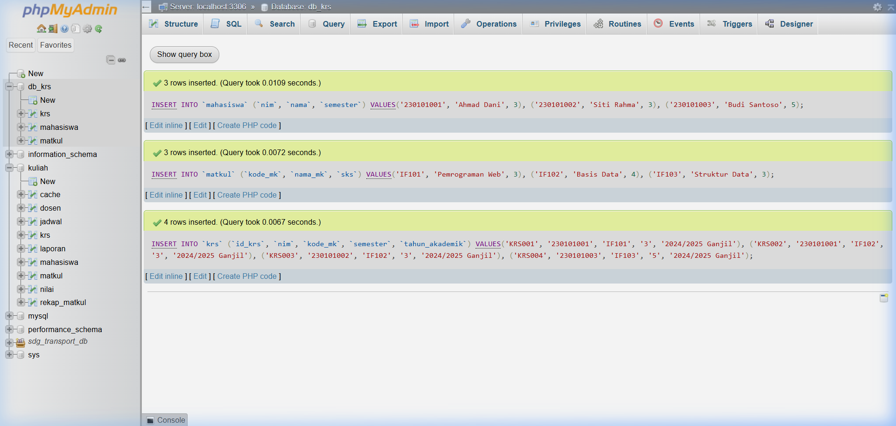
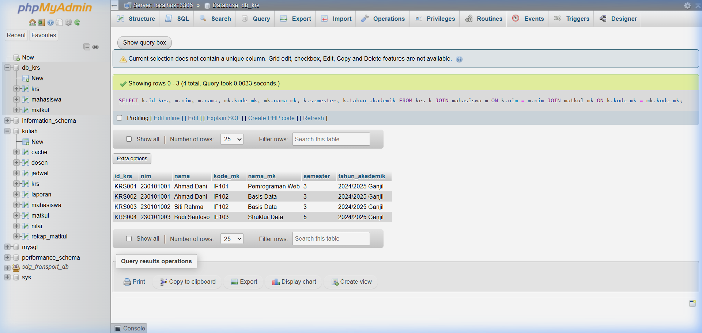
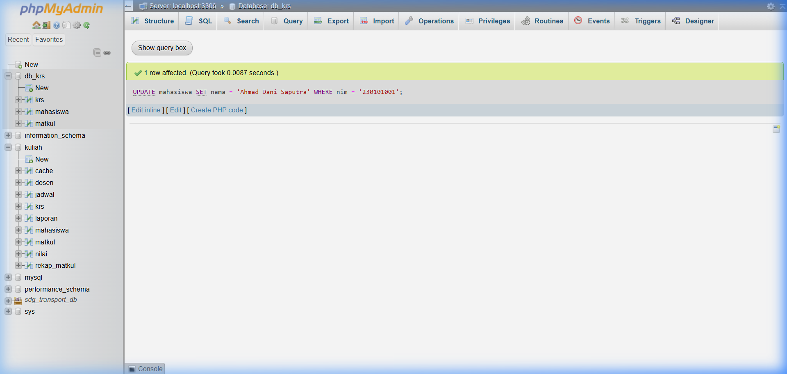
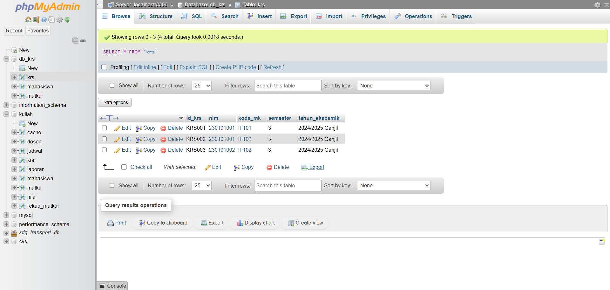

# SOAL 2: Operasi CRUD Dasar [Bobot: 50%]

> **(SCPMK0720802 - CRUD Dasar)** Manipulasi baris data dasar.

Berdasarkan 3 tabel yang telah Anda buat di Soal 1, lakukan urutan operasi operasional berikut menggunakan kode SQL:

1. [CREATE] Lakukan INSERT minimal 3 baris data dummy ke masing-masing tabel (total 9 baris data).
2. [READ] Tampilkan seluruh isi salah satu Tabel Induk menggunakan perintah SELECT *.
3. [UPDATE] Ubah satu nilai data (misal: mengubah harga, mengubah status, atau memperbaiki nama) pada Tabel Transaksi. Wajib menggunakan klausa WHERE pada Primary Key agar tidak terjadi update massal.
4. [DELETE] Hapus salah satu baris data dummy pada Tabel Transaksi. Wajib menggunakan klausa WHERE.

---

## Jawaban

### 1. CREATE — INSERT Data Dummy

```sql
-- Insert ke tabel mahasiswa (Tabel Induk)
INSERT INTO `mahasiswa` (`nim`, `nama`, `semester`) VALUES
  ('264311001', 'Andi Pratama',   3),
  ('264311002', 'Budi Santoso',   5),
  ('264311003', 'Citra Dewi',     7);

-- Insert ke tabel matkul (Tabel Induk)
INSERT INTO `matkul` (`kode_mk`, `nama_mk`, `sks`) VALUES
  ('MK001', 'Basis Data',          3),
  ('MK002', 'Pemrograman Web',     3),
  ('MK003', 'Jaringan Komputer',   2);

-- Insert ke tabel krs (Tabel Transaksi)
INSERT INTO `krs` (`id_krs`, `nim`, `kode_mk`, `semester`, `tahun_akademik`) VALUES
  ('KRS001', '264311001', 'MK001', 'Ganjil', '2024/2025'),
  ('KRS002', '264311002', 'MK002', 'Ganjil', '2024/2025'),
  ('KRS003', '264311003', 'MK003', 'Ganjil', '2024/2025');
```

**Screenshot hasil INSERT di phpMyAdmin:**



### 2. READ — Tampilkan Seluruh Isi Tabel Induk

```sql
-- Menampilkan semua data pada tabel mahasiswa
SELECT * FROM `mahasiswa`;
```

**Screenshot hasil SELECT di phpMyAdmin:**



### 3. UPDATE — Ubah Data pada Tabel Transaksi

```sql
-- Mengubah tahun_akademik pada KRS dengan id_krs = 'KRS001'
UPDATE `krs`
SET `tahun_akademik` = '2025/2026'
WHERE `id_krs` = 'KRS001';
```

**Screenshot hasil UPDATE di phpMyAdmin:**



### 4. DELETE — Hapus Satu Baris Data pada Tabel Transaksi

```sql
-- Menghapus data KRS dengan id_krs = 'KRS003'
DELETE FROM `krs`
WHERE `id_krs` = 'KRS003';
```

**Screenshot hasil DELETE di phpMyAdmin:**


