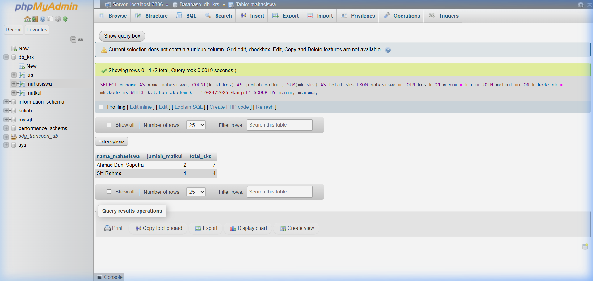

# SOAL 3: Query Kompleks & Agregasi Laporan [Bobot: 10%]

> **(SCPMK0720803 - WHERE, JOIN, Aggregasi)** Ekstraksi Penarikan Data

Sistem aplikasi proyek Anda membutuhkan sebuah **"Laporan Ringkasan"**.

Buatlah **SATU** perintah SQL query tunggal yang harus memuat keempat komponen ini sekaligus dalam satu sintaks:

1. **SELECT** — Menampilkan minimal satu nama kolom dari Tabel Induk dan satu hasil fungsi agregat (contoh: `SUM()`, `COUNT()`, `AVG()`).
2. **JOIN** — Menggabungkan minimal 2 tabel (Tabel Induk dan Tabel Transaksi) agar data yang ditarik relevan.
3. **WHERE** — Mem-filter/menyaring data berdasarkan kondisi tertentu (misal: hanya transaksi yang statusnya `'Selesai'`, atau tanggal tertentu).
4. **GROUP BY** — Mengelompokkan hasil agregasi berdasarkan atribut induk (misal: dikelompokkan per Nama Pelanggan, atau per Nama Kategori).

> **Contoh:** Ada tabel `mahasiswa (id_mhs, nama_mhs)` dan `rps (id_mhs, id_mk, sks)`, ingin mendapatkan total SKS dari tiap mahasiswa:
>
> ```sql
> SELECT nama_mhs, COUNT(sks) AS total_sks
> FROM rps a
> JOIN mahasiswa b ON a.id_mhs = b.id_mhs
> GROUP BY a.nama_mhs;
> ```
>
> | nama_mhs | total_sks |
> |----------|-----------|
> | budi     | 13        |
> | anis     | 20        |

---

## Jawaban

```sql
SELECT
    m.nama                  AS nama_mahasiswa,
    COUNT(k.id_krs)         AS jumlah_matkul,
    SUM(mk.sks)             AS total_sks
FROM mahasiswa m
JOIN krs k   ON m.nim      = k.nim
JOIN matkul mk ON k.kode_mk = mk.kode_mk
WHERE k.tahun_akademik = '2024/2025'
GROUP BY m.nim, m.nama;
```

**Penjelasan komponen:**

| Komponen | Implementasi |
|---|---|
| `SELECT` | `m.nama` (kolom Tabel Induk) + `COUNT()` & `SUM()` (fungsi agregat) |
| `JOIN` | `mahasiswa` ↔ `krs` ↔ `matkul` (3 tabel digabung) |
| `WHERE` | Filter hanya KRS tahun akademik `'2024/2025'` |
| `GROUP BY` | Dikelompokkan per `nim` & `nama` mahasiswa |

**Screenshot hasil query di phpMyAdmin:**


